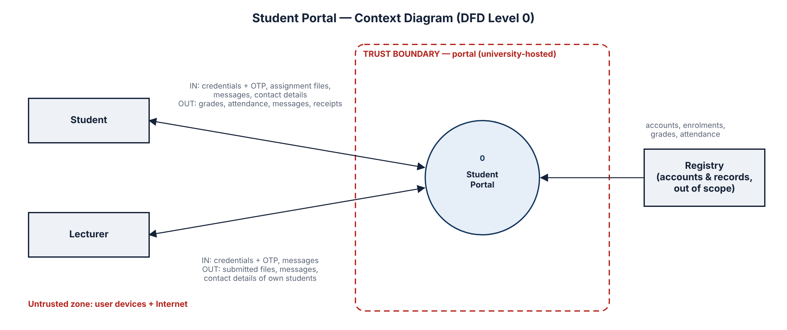
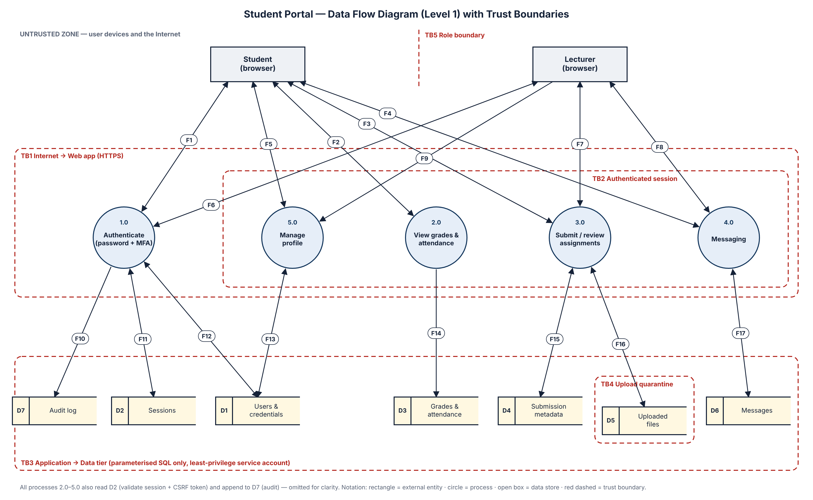

# Student Portal — Threat Model and Security Design

This document follows the order of the work: **security requirements → data flow diagram → trust boundaries → threats → controls in code → UI design principles**. Every control named here exists in the code and has an automated test in `tests/test_security.py`.

## 1. Scope, assets and security requirements

| # | User story | Feature | Security assumption (from Lab 1 Part 1) | Asset to protect |
|---|---|---|---|---|
| 1 | Student logs in to view grades | Login, grades and attendance | Only valid users can log in | Credentials, sessions, academic records |
| 2 | Student uploads assignments | File upload, lecturer download | Only .pdf / .docx are accepted | Lecturer's device, server storage, submission integrity |
| 3 | Lecturer sends messages to students | Messaging | Messages are protected in transit | Message confidentiality and integrity |
| 4 | Student updates profile | Profile | Contact info visible only to the student's own lecturers, never to other students | Personal data (email, phone, address, emergency contact) |

Out of scope for this build: the Registry's administration of accounts, enrolments, grades and attendance (seeded as demo data), password reset and MFA recovery (handled in person by the Registry helpdesk).

## 2. Data flow diagrams

**Level 0 — context**

**Level 1 — processes, data stores and trust boundaries**

Regenerate both with `python docs/make_dfd.py`.

### Data flows

| Flow | From → to | Data | Boundary crossed |
|---|---|---|---|
| F1 | Student ↔ 1.0 Authenticate | Username, password, CAPTCHA answer, TOTP code → session cookie | TB1 |
| F2 | Student ↔ 2.0 Grades | Request → own grades and attendance | TB1, TB2 |
| F3 | Student ↔ 3.0 Assignments | PDF/DOCX file → receipt (SHA-256); own file back | TB1, TB2 |
| F4 | Student ↔ 4.0 Messaging | Message text both ways | TB1, TB2 |
| F5 | Student ↔ 5.0 Profile | Contact details both ways (+ password when email changes) | TB1, TB2 |
| F6 | Lecturer ↔ 1.0 Authenticate | Same as F1 | TB1 |
| F7 | Lecturer ↔ 3.0 Assignments | Submission list, **student-supplied files downloaded to the lecturer's device** | TB1, TB2, TB5 |
| F8 | Lecturer ↔ 4.0 Messaging | Message text both ways | TB1, TB2 |
| F9 | 5.0 Profile → Lecturer | Contact details of the lecturer's own students (read-only) | TB1, TB2, TB5 |
| F10 | 1.0 → D7 Audit log | Authentication events (no secrets) | TB3 |
| F11 | 1.0 ↔ D2 Sessions | Hashed session token, state, CSRF token | TB3 |
| F12 | 1.0 ↔ D1 Users | Argon2id hash, TOTP secret, lockout counters | TB3 |
| F13 | 5.0 ↔ D1 Users | Contact fields | TB3 |
| F14 | D3 → 2.0 | Grades, attendance (read-only) | TB3 |
| F15 | 3.0 ↔ D4 | Submission metadata, hash, scan status | TB3 |
| F16 | 3.0 ↔ D5 | File bytes under a random name | TB3, TB4 |
| F17 | 4.0 ↔ D6 | Messages | TB3 |

## 3. Trust boundaries

A trust boundary is a place where data moves between zones with different levels of trust. Everything arriving across one is validated on the trusted side.

| ID | Boundary | Why trust changes here | What the code does at the boundary |
|---|---|---|---|
| **TB1** | Internet → web application | Anyone on the Internet can send any bytes; the network path can be observed or altered | HTTPS only with HSTS and Secure cookies; plain HTTP redirected; TLS 1.2/1.3 at the proxy (`deploy/nginx.conf`); request size cap; CSP and other headers; generic error pages |
| **TB2** | Anonymous → authenticated session | Before this point the caller is unknown; after it the caller acts as a named user | Password (Argon2id) **and** TOTP; throttling, CAPTCHA, lockout; new session id at each privilege change; idle and absolute timeouts; CSRF token on every state-changing request |
| **TB3** | Application → data tier | The database trusts whatever the application sends it | Bound parameters in every SQL statement; passwords stored only as Argon2id hashes; session tokens stored only as SHA-256 hashes; no secrets in the audit log |
| **TB4** | Upload quarantine | File content is attacker-controlled even after it is stored | Extension allow-list, content check, zip-bomb and macro checks, optional ClamAV scan; random file name, no extension, mode 0600, directory outside the web root; served only as an attachment with `nosniff` and a sandbox CSP |
| **TB5** | Student ↔ lecturer (role and ownership) | Two authenticated users are not allowed to see each other's data by default; files move from a student's device to a lecturer's device | Role check on every lecturer or student route; ownership or teaching-relationship check on every record addressed by id; refusals return 404 and are logged |

The browser is always on the untrusted side. Navigation that hides links, `accept=".pdf,.docx"`, `maxlength` and the JavaScript checks are usability aids only; the server repeats every check.

## 4. Threats, controls and where they live in the code

ATT&CK technique → ASVS 5.0 requirement → implementation → test. Requirement text was checked against the ASVS 5.0.0 release.

### Story 1 — Login (TB1, TB2)

| Threat | ATT&CK | ASVS 5.0 | Control in code | Test |
|---|---|---|---|---|
| Password guessing, spraying, credential stuffing | T1110 Brute Force (.001, .003, .004) | 6.3.1, 6.1.1, 2.4.1 | `security.login_risk`: CAPTCHA after 3 failures, account paused 15 min after 5, source address paused after 30. Attempts while paused are not counted, so an attacker cannot extend a victim's lockout indefinitely | `test_captcha_then_lockout_even_with_correct_password` |
| Stolen or guessed password is enough to get in | T1078 Valid Accounts | 6.3.3, 6.5.1 | Mandatory TOTP for every account (`auth.mfa`, `auth.mfa_enrol`); each code works once (`security.verify_totp`); 5 wrong codes discards the half-open session | `test_password_alone_does_not_grant_access`, `test_totp_code_cannot_be_replayed` |
| Discovering which usernames exist | T1589 Gather Victim Identity Information | 6.3.8 | One message for every failure cause (`auth.GENERIC_FAIL`); a password hash is always computed, so timing is the same; lockout is keyed on the submitted name whether or not it exists | `test_unknown_user_and_wrong_password_are_indistinguishable` |
| Offline cracking after a database leak | T1110.002 Password Cracking | 11.4.2, 6.2.1, 6.2.4, 6.2.5 | Argon2id (`security.hash_password`); 12-character minimum, no composition rules, deny-list | `test_password_change_enforces_policy_and_signs_out_other_sessions` |
| Session fixation or reuse of a stolen cookie | T1539 Steal Web Session Cookie | 7.2.4, 7.3.1, 7.3.2, 7.4.1, 3.3.1, 3.3.2, 3.3.4 | Server-side sessions; id rotated at password and at MFA step (`security.rotate_session`); 15 min idle, 8 h absolute; deleted on logout; `__Host-` cookie, Secure, HttpOnly, SameSite=Strict | `test_session_id_rotates_on_login_and_dies_on_logout`, `test_idle_timeout_enforced_server_side` |
| Forged request from another site | T1185 Browser Session Hijacking | 3.5.1, 3.5.3 | Per-session CSRF token checked in `security.load_session` for every non-GET request; logout is a POST | `test_post_without_csrf_token_is_rejected` |
| Default or shared initial passwords | T1078.001 Default Accounts | 6.3.2, 6.4.1 | `manage.py init-db` generates a random password per account and prints it once | — |

### Story 2 — Assignment upload (TB1, TB2, TB4, TB5)

| Threat | ATT&CK | ASVS 5.0 | Control in code | Test |
|---|---|---|---|---|
| Lecturer opens a malicious document | T1204.002 User Execution: Malicious File | 5.1.1, 5.2.2, 5.4.3 | `uploads.validate`: extension allow-list, PDF signature, DOCX structure, macros and PDF script actions rejected; `uploads.malware_scan` uses ClamAV when installed and otherwise labels the file "Not virus-scanned" for the lecturer | `test_dangerous_uploads_are_rejected` (8 cases) |
| Disguised file type (`report.pdf.exe`, renamed EXE) | T1036.008 Masquerade File Type | 5.2.2 | Content must match the extension | same |
| Upload executed or rendered by the server or browser | T1505.003 Web Shell, T1059.007 JavaScript | 5.3.1, 5.3.2, 5.4.1, 5.4.2 | `uploads.store`: random name, no extension, outside `static/`; `views.download`: server-generated download name, `Content-Disposition: attachment`, `nosniff`, sandbox CSP | `test_valid_upload_is_stored_safely_and_served_as_attachment` |
| Storage exhaustion or zip bomb | T1499 Endpoint Denial of Service | 5.2.1, 5.2.3 | 10 MB cap before parsing (`MAX_CONTENT_LENGTH`), declared unpacked size and entry count checked before decompressing, one file per assignment per student | `test_oversized_upload_is_rejected` |
| Reading or replacing another student's submission | T1078 Valid Accounts (IDOR) | 8.2.2 | `views.submit` checks enrolment; `views.download` allows only the owner or the course lecturer | `test_submission_access_is_limited_to_owner_and_course_lecturer` |
| "I never submitted that" / tampering after submission | T1565.001 Stored Data Manipulation | 16.3.1 | SHA-256 stored and shown to the student as a receipt and to the lecturer; audit entry | same |

### Story 3 — Messaging (TB1, TB2, TB5)

| Threat | ATT&CK | ASVS 5.0 | Control in code | Test |
|---|---|---|---|---|
| Message read or altered in transit | T1565.002 Transmitted Data Manipulation, T1557 Adversary-in-the-Middle | 12.1.1, 12.2.1, 12.2.2, 3.4.1 | HTTP redirected to HTTPS and HSTS sent (`portal/__init__.py`); TLS 1.3/1.2 only at the proxy (`deploy/nginx.conf`) | `test_plain_http_is_redirected_to_https`, `test_security_headers_and_cookie_flags` |
| Script injected through a message | T1059.007 JavaScript (stored XSS) | 1.2.1, 3.4.3 | Jinja auto-escaping, body shown as plain text; CSP without `unsafe-inline` | `test_cannot_read_someone_elses_message_and_body_is_escaped` |
| Reading someone else's message by changing the id | T1078 (IDOR) | 8.2.2 | `views.message` allows only sender or recipient | same |
| Messaging arbitrary users (spam, internal phishing) | T1534 Internal Spearphishing | 8.2.1, 2.4.1 | `security.allowed_contacts`: students ↔ lecturers of shared courses only; 30 messages per hour | `test_messages_only_between_lecturer_and_their_students` |

### Story 4 — Profile (TB1, TB2, TB5)

| Threat | ATT&CK | ASVS 5.0 | Control in code | Test |
|---|---|---|---|---|
| Viewing another student's contact details | T1078 Valid Accounts (IDOR) | 8.2.2, 8.3.1, 14.2.4 | `/profile` uses the session's user id only; `views.student` requires `security.lecturer_teaches`; home address is not shown to lecturers | `test_student_cannot_view_other_students_or_lecturer_pages`, `test_lecturer_sees_only_students_they_teach` |
| Changing fields that should not be editable (role, id) | T1098 Account Manipulation | 8.2.3, 2.2.1 | `views.PROFILE_RULES` allow-list with a validation rule per field; everything else in the form is ignored | `test_profile_update_ignores_extra_fields_and_validates` |
| Hijacked session used to take over the account | T1098 Account Manipulation | 7.5.1, 6.2.3 | Email change and password change require the current password; password change signs out other sessions | `test_email_change_requires_current_password` |
| Personal data left in caches or logs | T1005 Data from Local System | 14.3.2, 14.2.1, 16.2.5 | `Cache-Control: no-store` on every page; no personal data in URLs; audit log records field names, not values | `test_audit_log_never_contains_secrets` |
| Denying an action afterwards | — (repudiation) | 16.3.1, 16.3.2 | `security.audit` records logins, refusals, uploads, downloads, contact views, profile changes; view with `python manage.py audit` | several tests assert audit rows |

## 5. Lab 1 Part 4 — mapping validation for stories 2 to 4

| Story | Traceable | Justifiable | Verifiable | Notes / gaps |
|---|---|---|---|---|
| 2 | T1204.002 targets the upload feature and maps to ASVS V5 File Handling (5.1.1, 5.2.2, 5.4.3) | Checks run on the server at the upload endpoint, before the file is stored and before a lecturer can download it | Upload .exe, renamed .exe, macro .docx, scripted PDF and an 11 MB file; each is refused and logged as `upload_rejected` | No antivirus engine by default, so files are labelled "Not virus-scanned"; the PDF script check is a heuristic |
| 3 | T1565.002 targets message transmission and maps to ASVS V12 Secure Communication (12.1.1, 12.2.1) | TLS is enforced at the only entry point (proxy + app redirect + HSTS), so it covers every flow, not only messages | Request over HTTP returns 308 to HTTPS; scan the proxy with `testssl.sh` or SSL Labs to confirm TLS 1.2/1.3 only | Messages are not encrypted at rest; the first visit is unprotected until HSTS is preloaded |
| 4 | T1078 / IDOR targets profile and contact data and maps to ASVS V8 Authorization (8.2.2, 8.2.3) and V14 (14.2.4) | The check sits in the server route that returns the data, using the session identity rather than a request parameter | Log in as student A and request `/students/<B>`; log in as a lecturer and request a student they do not teach; both return 404 and write `authz_denied` | A lecturer's own account compromise still exposes that lecturer's students; mitigated by MFA and the audit trail |

### A note on the control IDs in the lab sheet

Some IDs on the sheet do not match ASVS 5.0.0, which renumbered most chapters. Worth confirming with your lecturer which version is expected:

| Sheet says | In ASVS 5.0.0 | Use instead |
|---|---|---|
| 6.4.1 for CAPTCHA | 6.4.1 is about system-generated initial passwords | 2.4.1 (anti-automation) and 6.1.1 (documented rate limiting) |
| 6.2.1 for MFA | 6.2.1 is minimum password length | 6.3.3 (multi-factor authentication) |
| "V4 Access Control 4.2.1" for username enumeration | V4 is now API and Web Service; access control moved to V8 | 6.3.8 (valid users cannot be deduced from failed logins) |
| 5.2.1 with the "documentation defines permitted file types" text | That text is 5.1.1; 5.2.1 is the size limit | 5.1.1, plus 5.2.2 for extension and content matching |
| 14.2.4 for IDOR | Correct but general | Add 8.2.2 (data-specific access) and 8.2.3 (field-level access) |

## 6. Secure coding principles applied

| Principle | Where |
|---|---|
| Validate at the trust boundary, on the server, with allow-lists | `uploads.validate`, `views.PROFILE_RULES`, recipient check in `views.message_new` |
| Never build queries or paths from user input | Bound SQL parameters everywhere; upload paths use a random name |
| Encode on output | Jinja auto-escaping; no `|safe`; no inline script or style, enforced by CSP |
| Deny by default, least privilege | `login_required` / `role_required` on every route; object checks before any record is returned |
| Complete mediation | Authorisation is re-checked on every request, never cached in the client |
| Fail securely | Generic error pages; refusals return 404; debug mode off; rejected uploads are deleted |
| Secure defaults | HTTPS-only unless `PORTAL_DEV=1` is set explicitly; MFA mandatory; random initial passwords |
| Defence in depth | Throttle + CAPTCHA + lockout + MFA; content check + scan + attachment-only download + lecturer warning |
| Do not store what you do not need | Passwords and session tokens stored as hashes; lecturers do not see home addresses |
| Log security events, not secrets | `security.audit` with control characters stripped |

## 7. UI security design principles applied

| Principle | How the interface applies it | Threat it supports |
|---|---|---|
| Errors help the user without helping an attacker | One sign-in error for all causes, which also tells the user about the 15-minute pause | T1589, T1110 |
| Make the secure path the easy path | Password managers and paste allowed, correct `autocomplete` values, show/hide password, length guidance instead of symbol rules | T1110 |
| Explain why a security step is being asked for | CAPTCHA, MFA setup and re-entering the password each have a one-line reason | T1110, T1098 |
| Show constraints before the user acts | Accepted file types and the 10 MB limit are stated above the upload control; the browser check gives instant feedback | T1204.002 |
| Warn at the point of risk | Lecturer's submissions page tells them to treat downloads as untrusted and shows scan status per file | T1204.002 |
| Make privacy visible | Profile page lists exactly who can and cannot see contact details; roster says views are logged | T1078 |
| Let users detect misuse | Previous sign-in time and address shown after login; upload receipt with a hash | T1078, T1565 |
| Show only what the role can use | Navigation differs for students and lecturers (and the server enforces it regardless) | T1078 |
| Protect unattended sessions without surprising the user | Two-minute warning before the idle timeout with one "Stay signed in" action; Sign out always visible | T1539 |
| Resist phishing and social engineering | Footer states the university never asks for passwords or codes; recovery is in person, not by email; message composer says not to send codes | T1566 |
| Accessible by default | Labels on every field, visible focus, `aria-live` errors, skip link, works at phone width | — |

## 8. Residual risks and known gaps

| Gap | Impact | Recommended next step |
|---|---|---|
| The arithmetic CAPTCHA only stops naive scripts | Brute-force protection rests on lockout and MFA | Replace with a real CAPTCHA service or proof-of-work |
| No antivirus scanner in the default setup | Known malware in a valid PDF/DOCX would be stored | Install ClamAV (picked up automatically) or scan in a sandbox |
| Password deny-list is short | Weak but unlisted passwords are accepted | Check against a breached-password set (ASVS 6.2.4, 6.2.12) |
| TOTP secrets, messages and contact data are not encrypted at rest | Exposed if the database file is stolen | Disk encryption plus field encryption with a managed key |
| Account lockout can be used to annoy a specific user for 15 minutes | Targeted denial of service | Notify the user; allow login from a previously seen device |
| SQLite and local file storage | Not suitable for multiple app servers | PostgreSQL with a least-privilege role; object storage for uploads |
| No self-service password reset or MFA recovery | Helpdesk workload | Add a reset flow that does not bypass MFA (ASVS 6.4.3, 6.4.4) |
